# HL7 / DICOM Tools

Single-file browser tools for HL7 v2.5.1 and DICOM: parse, diff, generate, view and simulate, with no install and no server.

**Live:** [coffeemilktea.github.io/hl7-dicom-tools](https://coffeemilktea.github.io/hl7-dicom-tools/) · Landing page: [coffeemilktea.github.io](https://coffeemilktea.github.io/)

## Tools

| Tool | Desktop | Mobile |
|---|---|---|
| **[HL7 Parser](https://coffeemilktea.github.io/hl7-dicom-tools/tools/msgparser.html)**: breaks an HL7 v2.5.1 message into segments, fields and components, with structured, highlighted and JSON views. Also reads FHIR R4 JSON/XML. · [`tools/msgparser.html`](tools/msgparser.html) | 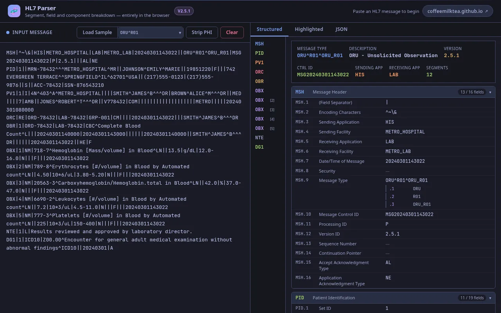 | 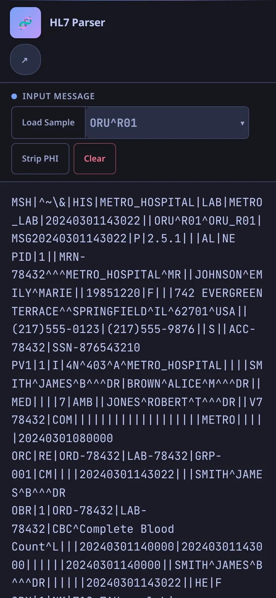 |
| **[HL7 Diff Checker](https://coffeemilktea.github.io/hl7-dicom-tools/tools/diff-checker.html)**: compares two HL7 v2.5.1 messages side by side, segment by segment and field by field. · [`tools/diff-checker.html`](tools/diff-checker.html) | 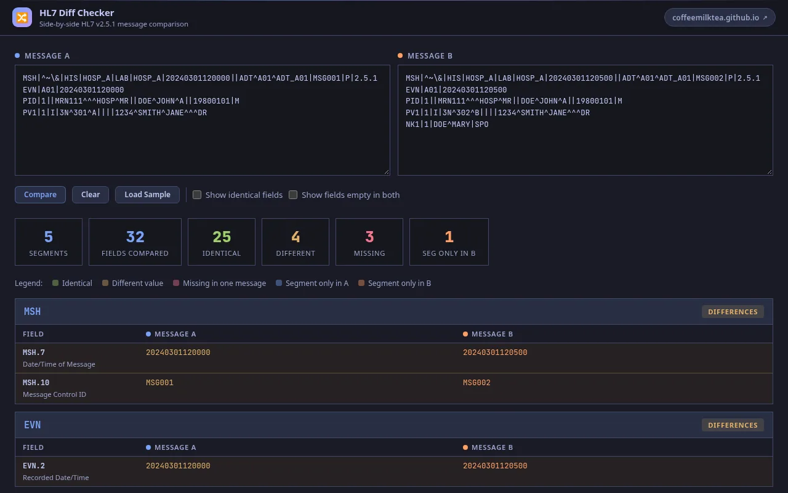 | 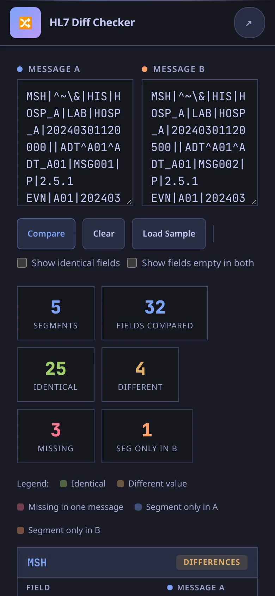 |
| **[DICOM → HL7 Order](https://coffeemilktea.github.io/hl7-dicom-tools/tools/dicom-hl7-order.html)**: reads DICOM tags and generates an HL7 v2.5.1 ORM^O01 radiology order, with editable overrides and a tag-to-field mapping table. · [`tools/dicom-hl7-order.html`](tools/dicom-hl7-order.html) | 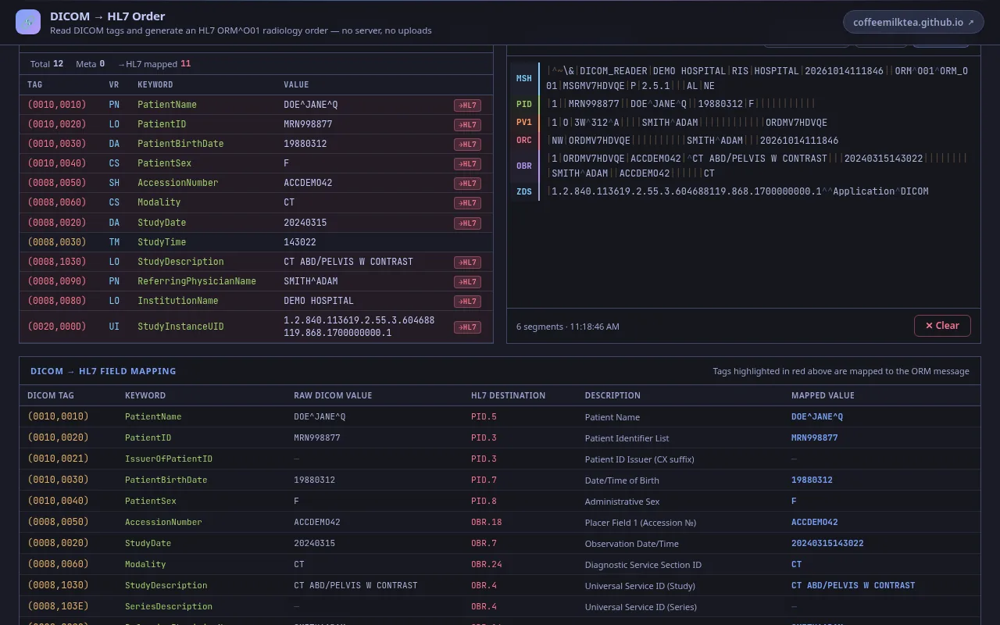 | 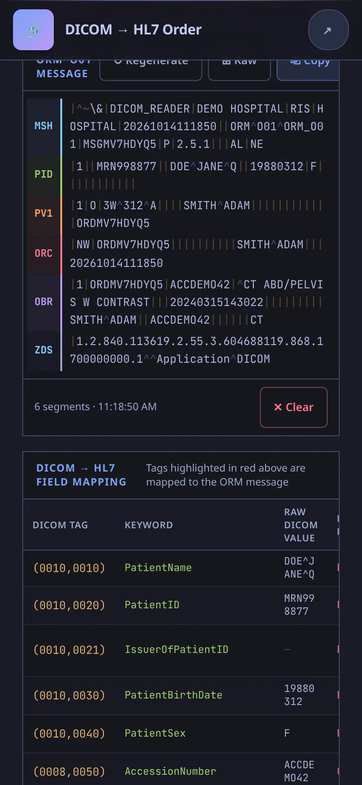 |
| **[DICOM Toolbox](https://coffeemilktea.github.io/hl7-dicom-tools/tools/dicom-generator.html)**: generates DICOM files from form fields and custom tags (optionally from an uploaded image), and reads them back in a tag browser. · [`tools/dicom-generator.html`](tools/dicom-generator.html) | 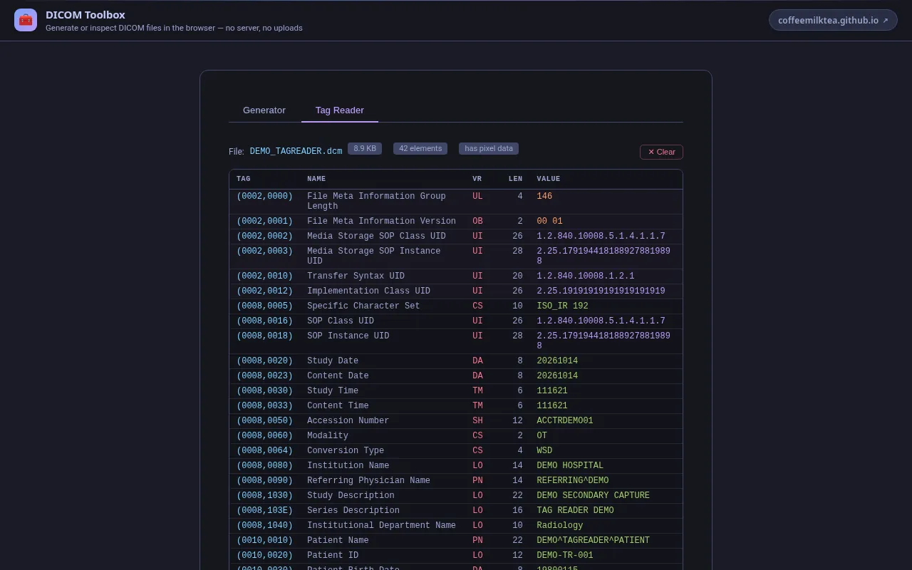 | 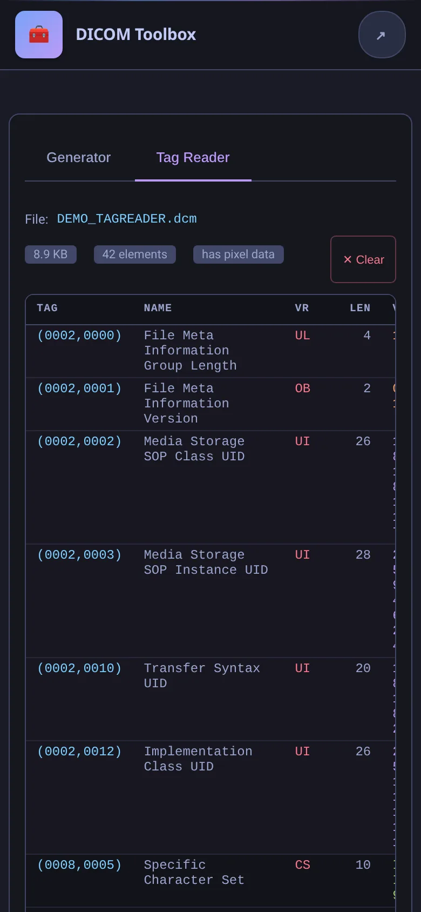 |
| **[DICOM Viewer & Tag Morph](https://coffeemilktea.github.io/hl7-dicom-tools/tools/dicom-viewer.html)**: opens DICOM files and folders, shows images with window/level, pan, zoom and measurement, and edits tags before re-export. · [`tools/dicom-viewer.html`](tools/dicom-viewer.html) | 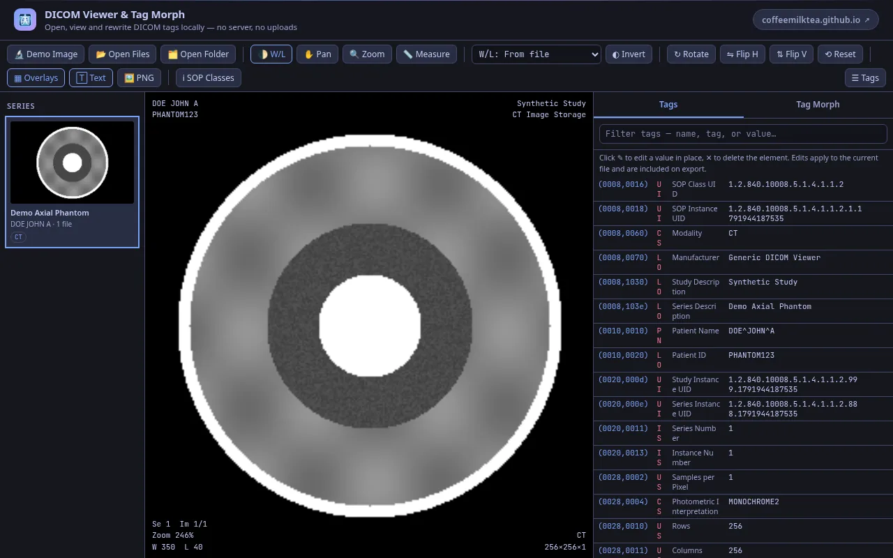 | 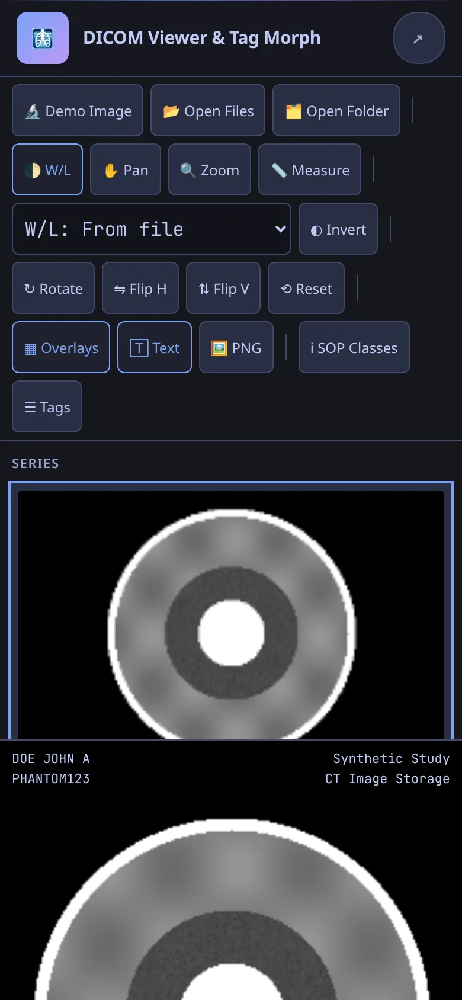 |
| **[DICOM MWL Simulator](https://coffeemilktea.github.io/hl7-dicom-tools/tools/mwl-simulator.html)**: runs Modality Worklist C-FIND queries against a simulated worklist, or against a DICOMweb (QIDO-RS) server you configure, and shows the protocol log. · [`tools/mwl-simulator.html`](tools/mwl-simulator.html) | 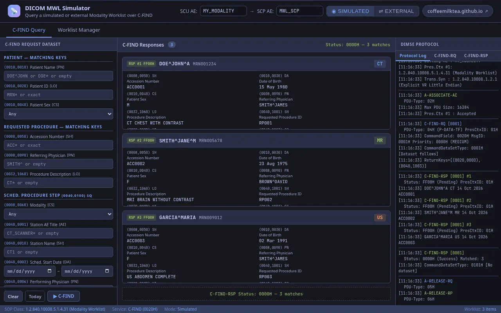 | 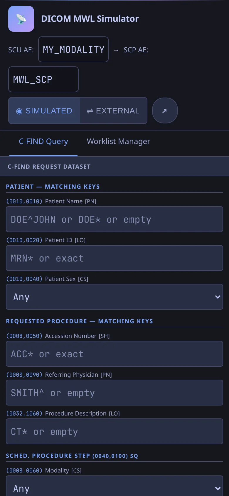 |

The Mirth Transformer Builder lives in a separate repo: [HL7-Interface-Javascript-Builder](https://github.com/coffeemilktea/HL7-Interface-Javascript-Builder).

## Features

- Each tool is a single HTML file with no build step and no third-party libraries.
- Sample data is built in: every tool has a sample or demo button, so you can try it without real data.
- HL7 handling: escape sequences (`\F\ \S\ \T\ \R\ \E\ \Xhh\ \.br\`) are decoded when parsing and applied when generating. Generated messages use CR (`\r`) as the segment terminator.
- DICOM text is decoded using the file's Specific Character Set (0008,0005) in the order tool and the Toolbox reader.
- Dark Tokyo Night theme shared by every tool (`tools/tokyo-night.css`, byte-identical to the landing site's copy).
- Mobile-friendly: 16px inputs on touch screens, 44px tap targets, wide tables scroll inside their own box, and safe-area insets are respected.

## HL7 standard: v2.5.1

All generated messages and samples use **HL7 v2.5.1**:
- MSH-12 = `2.5.1`, and MSH-9 includes the message structure (for example `ORM^O01^ORM_O01`).
- Field definitions follow v2.5.1; MSH ends at MSH-21.
- The parser flags any message whose MSH-12 isn't 2.5.1.

## Privacy

Files and messages are parsed in your browser and are not uploaded anywhere. The one exception is the MWL Simulator's **External** mode, which sends QIDO-RS queries to the DICOMweb URL you enter. Simulated mode makes no network requests.

## Local development

```bash
git clone https://github.com/coffeemilktea/hl7-dicom-tools.git
cd hl7-dicom-tools
python3 -m http.server 8000   # then open http://localhost:8000/tools/msgparser.html
```

Any static file server works, and so does opening a tool directly as a file. The landing page (`index.md`, `_layouts/default.html`) is built by GitHub Pages with Jekyll (`jekyll-seo-tag`).

## Tech

- Plain HTML, CSS and JavaScript (ES2015+); no frameworks and no dependencies.
- `tools/tokyo-night.css`: palette tokens and base components. `tools/theme.css`: the tool header and buttons. `tools/theme.js`: shared helpers (toast and live region, keyboard support for drop zones and tabs, scroll wrappers for wide tables).
- Published with GitHub Pages from `main`.
